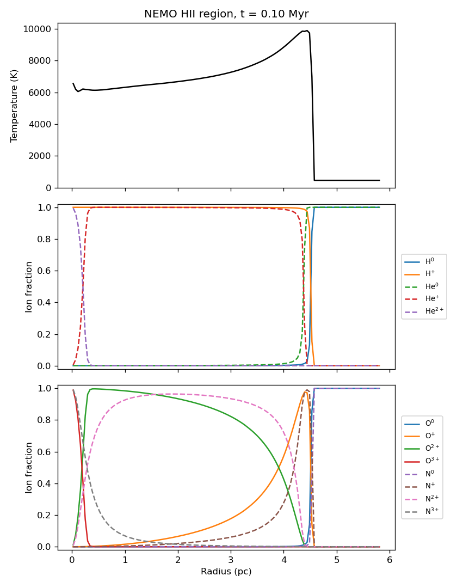

.. _example-nemo:

An HII region with NEMO (1D)
================================

This example calculates the ionisation and temperature structure of an HII region around a hot star with the NEMO microphysics library (see :ref:`ref-nemo`).
NEMO follows all ionisation stages of H, He, C, N, O, Ne, Si, S and Fe, so the result shows how the ions of each element are arranged around the star, e.g. :math:`\mathrm{O}^{2+}` close to the star and :math:`\mathrm{O}^{+}` near the edge of the HII region.

The setup is a 1D spherically symmetric HII region around a star with an effective temperature of 40,000 K, in gas with a hydrogen number density of about :math:`100\,\mathrm{cm}^{-3}`.
It is based on the HII40 model of the Lexington photoionisation-code benchmarks (Ferland et al. 1995).
The hydrodynamics is switched off, so the gas does not move, and the simulation runs until the gas is in ionisation and thermal equilibrium.

Requirements
------------

+ PION compiled with NEMO (``-DPION_NEMO=ON``, see :ref:`ref-nemo`), with Silo, and preferably with MPI and OpenMP.
+ PyPion and matplotlib, to make the plot (see :ref:`python_usage`).
+ The parameter file :download:`params_HII40_NEMO_n128.txt <ex-nemo/params_HII40_NEMO_n128.txt>` and the plotting script :download:`plot_hii40.py <ex-nemo/plot_hii40.py>`.

The same setup with 32 cells is one of PION's tests (``hii40-nemo``, see :ref:`tests`), with the parameter file ``test/ci-inputs/params_HII40_NEMO_n032.txt``.

The parameter file
------------------

The important parts of the parameter file are described here; all parameters are listed in :ref:`parameter-file`.

**Grid and equations**: a 1D spherical grid of 128 cells from the star at :math:`r=0` to :math:`1.8\times10^{19}` cm (5.8 pc).
``EP_dynamics 0`` switches the hydrodynamics off, so only the radiative transfer and the microphysics change the gas.

.. code-block:: none

  ndim 1
  eqn euler
  coordinates spherical
  NGridX  128
  Xmin 0.0
  Xmax 1.8e19
  EP_dynamics     0

**Microphysics and species**: NEMO, with the mass fractions of 9 elements (``X_H`` to ``X_Fe``) and of the ions of each element (99 tracers in total).
For each element the tracers go from the neutral atom to the second-highest ionisation stage; the fully ionised stage (e.g. :math:`\mathrm{H}^+`, :math:`\mathrm{He}^{2+}`) is calculated by NEMO from the element and the other ions.
See :ref:`ref-nemo` for the rules for naming and ordering the tracers.

.. code-block:: none

  chem_code NEMO
  EP_chemistry    1
  InitIons LEAVE
  ntracer 99
  Tracer000 X_H
  Tracer001 X_He
  ...
  Tracer008 X_Fe
  Tracer009 H
  Tracer010 He
  Tracer011 He1+
  Tracer012 C
  Tracer013 C1+
  ...

**Initial conditions**: a uniform, neutral, cold medium (``ics Uniform``).
The initial values of the tracers are ``UNIFORM_ambTR0``, ``UNIFORM_ambTR1``, etc.: the element mass fractions, the same values for the neutral atoms, and :math:`10^{-18}` for all of the ions.
With ``InitIons LEAVE``, ``icgen`` keeps these values.

.. code-block:: none

  ics Uniform
  UNIFORM_ambRO 2.359e-22    # g/cm^3, i.e. n_H ~ 100 per cm^3
  UNIFORM_ambPG 1.0e-11      # dyne/cm^2, about 600 K
  UNIFORM_ambTR0    7.0933e-01   # X_H
  UNIFORM_ambTR1    2.8373e-01   # X_He
  ...
  UNIFORM_ambTR9    7.0933e-01   # H (all neutral)
  UNIFORM_ambTR11   1.00e-18     # He1+
  ...

**Physical processes**: photoionisation by the star (which needs ray-tracing), collisional ionisation, radiative recombination, charge exchange, cosmic-ray ionisation, and heating and cooling of the gas.
The microphysics limits the timestep (``EP_MP_timestep_limit 1``).

.. code-block:: none

  EP_raytracing   1
  EP_phot_ionisation   1
  EP_cooling      1
  EP_coll_ionisation   1
  EP_rad_recombination 1
  EP_charge_exchange 1
  EP_cr_ionisation 1
  EP_update_erg 1
  EP_MP_timestep_limit 1
  EP_nemo_reltol 1.0e-6
  EP_nemo_abstol 1.0e-12

**The star**: a point source at the origin with a blackbody spectrum (``RT_effect___0 10``) of effective temperature 40,000 K and radius 18.65 solar radii, so its luminosity (``RT_strength_0``) is :math:`4\pi R^2\sigma T^4 = 3.07\times10^{39}` erg/s.
NEMO uses 15 energy bins for the ionising radiation (``RT_Nbins____0 15``).

.. code-block:: none

  RT_Nsources 1
  RT_position_0_0  0.0
  RT_strength_0    3.07e39
  RT_Rstar____0    18.6517
  RT_Tstar____0    4.0e4
  RT_effect___0    10
  RT_Nbins____0    15
  RT_EVO_FILE_0    NOFILE

**Output**: a snapshot every 0.01 Myr (``OPfreqTime``) until 0.1 Myr (``FinishTime``, in seconds).

.. code-block:: none

  OutputFile HII40_n128
  OutputCriterion 1
  OPfreqTime 3.156e11
  FinishTime 3.156e+12

Running the simulation
----------------------

Make the initial conditions, and then run the simulation, here with 4 MPI processes and 2 OpenMP threads each (32 cells per process):

.. code-block:: bash

  $ mpirun -np 1 /path/to/pion/build/icgen-ug params_HII40_NEMO_n128.txt redirect=ic
  $ mpirun -np 4 /path/to/pion/build/pion-ug HII40_n128_0000.00000000.silo omp-nthreads=2 redirect=run

This takes about 10 minutes on a desktop computer (about 2900 timesteps).
Almost all of the timesteps are in the first 0.01 Myr, while the ionisation front moves out from the star and the gas heats up; after that the gas is close to equilibrium and the timesteps are much longer.
The recombination time of hydrogen at this density is about 1000 years, so the HII region reaches equilibrium long before 0.1 Myr.
The 32-cell version takes about 2 minutes.

The log files ``run_0.log``, etc., show the progress (see :ref:`command-line-logs`), and the snapshots are ``HII40_n128_0000.<step>.silo``.

Plotting the results
--------------------

The script ``plot_hii40.py`` reads a snapshot with PyPion, and plots the temperature and the ion fractions of H, He, N and O against radius.
It reads the tracer names from the parameter file, because the Silo variable of each tracer is named after its number and name, e.g. ``Tr011_He1p`` for tracer 11, ``He1+`` (``+`` is written as ``p``).
The fraction of the fully ionised stage of each element is one minus the sum of the other stages.

.. code-block:: bash

  $ python3 plot_hii40.py params_HII40_NEMO_n128.txt HII40_n128_0000.00002864.silo hii40_nemo.png

(the step number of the last snapshot may be different on your computer).

.. _fig-hii40-nemo:

  Temperature (top), and ion fractions of H and He (middle) and of O and N (bottom) against radius, at 0.1 Myr.

:numref:`fig-hii40-nemo` shows the result:

+ The ionised region extends to 4.5 pc, with a sharp ionisation front, where the gas changes from fully ionised to neutral over a few cells.
+ The temperature is 6000–7000 K close to the star and rises to almost 10,000 K near the ionisation front, where the radiation is harder because the softer photons have been absorbed on the way out.  Outside the front the neutral gas, which is only heated by cosmic rays, cools from its initial 600 K to about 460 K.
+ Helium is mostly :math:`\mathrm{He}^{+}` almost everywhere in the HII region, and :math:`\mathrm{He}^{2+}` only very close to the star; a 40,000 K star emits few photons that can ionise :math:`\mathrm{He}^+` (above 54.4 eV).
+ Oxygen is mostly :math:`\mathrm{O}^{2+}` in the inner part of the HII region, and :math:`\mathrm{O}^{+}` in the outer part; nitrogen is mostly :math:`\mathrm{N}^{2+}`.

Things to try
-------------

+ Change the temperature of the star (``RT_Tstar____0``, and ``RT_strength_0`` to keep the luminosity consistent) to see how the ionisation of He and O depends on the spectrum.
+ Switch off charge exchange (``EP_charge_exchange 0``) and compare the :math:`\mathrm{O}^{+}` and :math:`\mathrm{N}^{+}` fractions near the ionisation front.
+ Switch on the hydrodynamics (``EP_dynamics 1``) and run for longer (a few Myr), to follow the expansion of the HII region as the hot, ionised gas pushes into the neutral gas.
+ For a 2D example with two stars and hydrodynamics, see :ref:`example-nemo-2d`.
