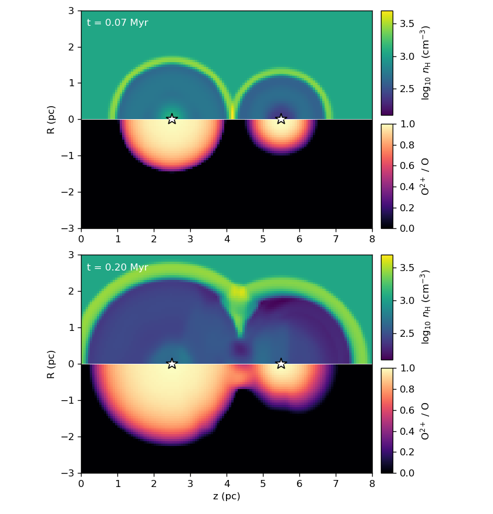

.. _example-nemo-2d:

Two merging HII regions with NEMO (2D)
=======================================

This example follows the HII regions of two hot stars that are 3 pc apart in dense gas, with the NEMO microphysics library (see :ref:`ref-nemo`) and hydrodynamics.
The HII regions start separate, expand as their hot ionised gas pushes into the surrounding neutral gas, and then run into each other.
Read the 1D example (:ref:`example-nemo`) first: the parameter file is set up in the same way.

Requirements
------------

+ PION compiled with NEMO (``-DPION_NEMO=ON``, see :ref:`ref-nemo`), with Silo, MPI and OpenMP.
+ PyPion and matplotlib, to make the plot (see :ref:`python_usage`).
+ The parameter file :download:`params_TwoSrc_NEMO_n128.txt <ex-nemo/params_TwoSrc_NEMO_n128.txt>` and the plotting script :download:`plot_twosrc.py <ex-nemo/plot_twosrc.py>`.

A smaller version of this setup, with the stars closer together, is one of PION's tests (``rhd-2d-nemo-2src``, see :ref:`tests`).

The setup
---------

+ **Grid**: 2D cylindrical coordinates (:math:`z`, :math:`R`), with 128 × 64 cells over 8 × 4 pc (0.0625 pc per cell). The :math:`z`-axis is the symmetry axis.
+ **Gas**: uniform, neutral gas at 600 K with a hydrogen number density :math:`n_\mathrm{H}\approx1100\,\mathrm{cm}^{-3}`. The elements are H, He and O, with tracers for all ionisation stages of O (14 tracers).
+ **Stars**: two blackbody point sources on the axis, at :math:`z=2.5` pc (40,000 K, the star of the 1D example) and :math:`z=5.5` pc (35,000 K, :math:`15\,R_\odot`). The radiation of both stars is ray-traced, and NEMO adds up the photoionisation and heating rates from both.
+ **Physics**: hydrodynamics (``EP_dynamics 1``) together with all of the microphysics of the 1D example, and the microphysics timestep limit (``EP_MP_timestep_limit 1``).
+ **Output**: a snapshot every 0.01 Myr until 0.2 Myr.

The Strömgren radii of the two stars are 1.0 and 0.67 pc, so the HII regions are at first separated by more than a parsec of neutral gas.
Once each ionisation front has reached its Strömgren radius, the HII region is at about 8000 K and has about 25 times the pressure of the cold neutral gas.
It expands, sweeping up a dense shell of neutral gas ahead of the ionisation front (a D-type ionisation front).

Running the simulation
----------------------

.. code-block:: bash

  $ mpirun -np 1 /path/to/pion/build/icgen-ug params_TwoSrc_NEMO_n128.txt redirect=ic
  $ mpirun -np 4 --map-by slot:PE=10 --bind-to core \
      /path/to/pion/build/pion-ug TwoSrc_n128_0000.00000000.silo omp-nthreads=10 redirect=run

(see :ref:`parallel` for the binding options).
This takes about 21,600 timesteps and about 1 hour with 4 MPI processes of 10 threads each.
The timestep, about 10 years, is set by the microphysics (``EP_MP_timestep_limit 1``), not by the hydrodynamics, which would allow timesteps of almost 1000 years.
Without this limit the simulation crashes in the first timestep, when the gas around the stars is heated from 600 K to :math:`10^4` K.

Plotting the results
--------------------

The script ``plot_twosrc.py`` plots the hydrogen number density in the upper half-plane (:math:`R>0`), and the fraction of oxygen in :math:`\mathrm{O}^{2+}` reflected into the lower half-plane (:math:`R<0`), with one panel for each snapshot:

.. code-block:: bash

  $ python3 plot_twosrc.py params_TwoSrc_NEMO_n128.txt TwoSrc_n128_0000.<step1>.silo \
      TwoSrc_n128_0000.<step2>.silo twosrc_nemo.png

.. _fig-twosrc-nemo:

  Hydrogen number density (upper half of each panel) and :math:`\mathrm{O}^{2+}` fraction (lower half) at 0.07 Myr (top) and 0.2 Myr (bottom). The stars are marked with white stars.

:numref:`fig-twosrc-nemo` shows:

+ At 0.07 Myr each HII region (:math:`n_\mathrm{H}\approx300\,\mathrm{cm}^{-3}`) is surrounded by a shell of swept-up neutral gas, and the two shells have just met on the axis, closer to the fainter star.
+ The shells collide and form a dense, neutral wall between the HII regions (:math:`n_\mathrm{H}\approx2000\text{--}4000\,\mathrm{cm}^{-3}`, about 2000 K), which separates them until about 0.16 Myr.
+ The radiation of both stars photoevaporates the wall from both sides. By 0.2 Myr the wall has been ionised out to about 0.7 pc from the axis, so that the two HII regions are joined there, while further out the remains of the wall are pushed towards the fainter star by the larger HII region. The larger HII region has reached the edge of the grid at :math:`z=0`.
+ Oxygen is almost all :math:`\mathrm{O}^{2+}` close to the 40,000 K star. The :math:`\mathrm{O}^{2+}` region of the cooler 35,000 K star is smaller, because it emits fewer photons above the 35 eV needed to ionise :math:`\mathrm{O}^{+}`. In the outer parts of both HII regions oxygen is mostly :math:`\mathrm{O}^{+}`, and in the ionised gas between them it is about half :math:`\mathrm{O}^{+}` and half :math:`\mathrm{O}^{2+}`.

Things to try
-------------

+ Plot the other ions, e.g. :math:`\mathrm{He}^{+}` or :math:`\mathrm{O}^{+}`, or the temperature, by changing the variables in ``plot_twosrc.py``.
+ Double the resolution (``NGridX 256``, ``NGridY 128``); this takes about 8 times as long.
+ Move the stars closer together or further apart, or change the density, to change when the HII regions meet.
